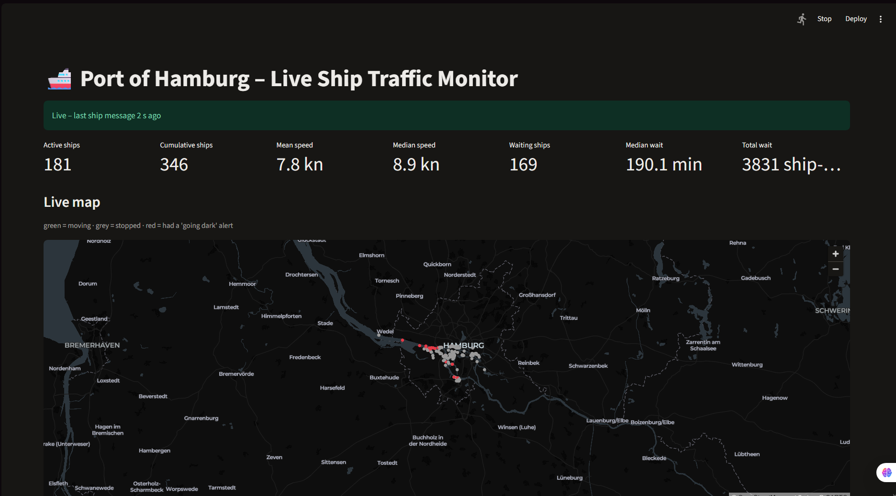
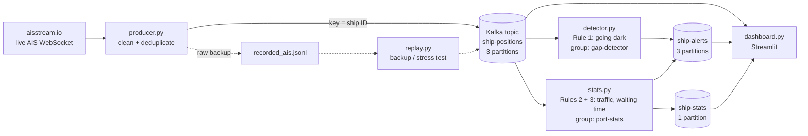
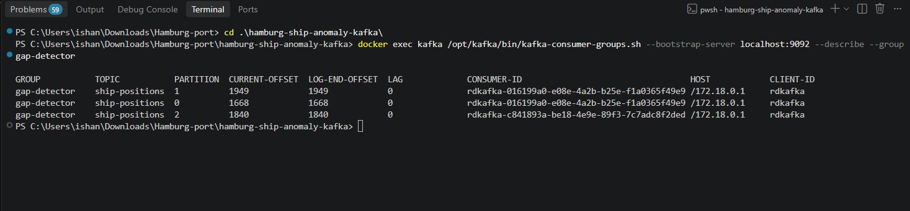
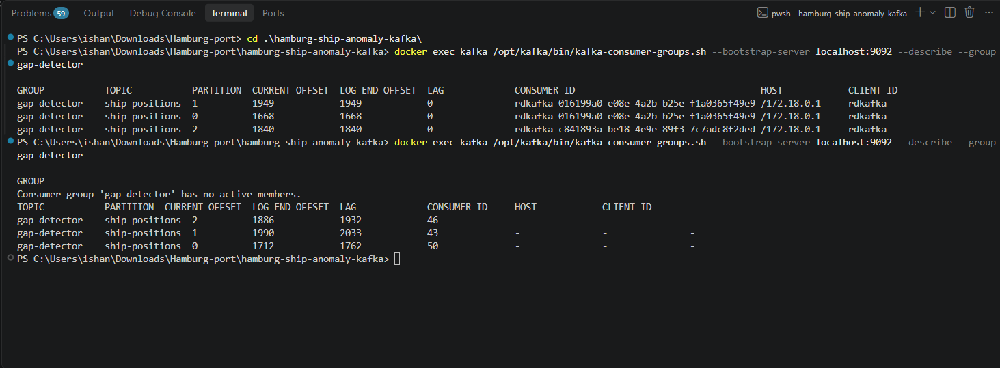
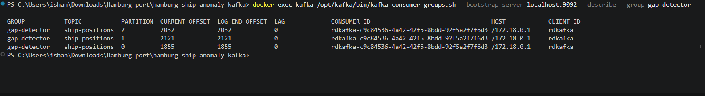
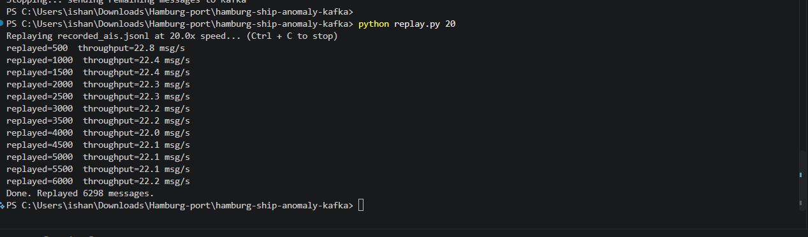

# 🚢 Port of Hamburg – Real-Time Ship Traffic Anomaly Detection

A data streaming pipeline that ingests **live AIS ship positions** around the Port of Hamburg and the Elbe, moves them through **Apache Kafka**, and detects anomalies and port KPIs in real time.

**Domain:** Logistics / maritime IoT  
**Business objective:** Anomaly detection and port monitoring: spot safety risks (ships "going dark"), measure port traffic, and track ship waiting times.



---

## 1. Data source: real, live AIS data

- **AIS (Automatic Identification System):** ships broadcast their identity, position, speed and course by radio every few seconds. AIS is mandatory for international ships of 300+ gross tonnage and for all passenger ships.
- **[aisstream.io](https://aisstream.io)** collects these signals from a worldwide network of receiving stations and streams them as JSON over a **WebSocket**, free with an API key.
- We subscribe to a bounding box around the Port of Hamburg and the Elbe: `[[53.45, 9.65], [53.62, 10.10]]`.
- No synthetic data is used. The backup `replay.py` only re-sends **real** messages recorded earlier.

---

## 2. Architecture



| Component | Role |
|---|---|
| `docker-compose.yml` | One Kafka broker (3.9, **KRaft mode**, no ZooKeeper) + Kafka UI at http://localhost:8080 |
| `producer.py` | Reads the live WebSocket, cleans messages, removes duplicates, sends to Kafka (idempotent) |
| `detector.py` | Rule 1 (signal gap). Scalable: run several copies in one consumer group |
| `stats.py` | Rules 2 and 3 (port statistics + dynamic alerts), one summary per minute |
| `dashboard.py` | Live Streamlit dashboard: map, KPIs, charts, alerts, pipeline health |
| `replay.py` | Re-sends recorded real data: backup for live demos and throughput stress test |

**Kafka topics**

| Topic | Partitions | Content | Key |
|---|---|---|---|
| `ship-positions` | 3 | cleaned position reports | ship ID (MMSI) |
| `ship-alerts` | 3 | anomaly alerts | ship ID / alert ID |
| `ship-stats` | 1 | one statistics record per minute | `port` |

The **ship ID as message key** sends all messages of one ship to the same partition, which keeps them **in order** and lets each detector instance see the full history of "its" ships.

---

## 3. Detection rules (business view)

### Rule 1: Signal gap ("going dark"): safety and security
- **Trigger:** a **moving** ship (> 1 kn) sends no AIS message for **more than 60 seconds** while inside the area.
- **Why it matters:** ships switching off AIS can indicate smuggling, illegal activity or a technical fault; port security wants to know immediately.
- **False-alarm protection:**
  - silence is measured in **event time** (ship timestamps), not computer time
  - if **no ship at all** sends data for 30 s, the data source is down, so that time is not counted
  - one event-time clock **per partition** (partitions are read in batches during catch-up)
  - ships near the edge of the area are ignored (they probably sailed out)

### Rule 2: Port traffic counter: capacity planning
Every minute: **active ships**, **cumulative unique ships** (only increases), **mean and median speed** of moving ships, **speed histogram**.  
**Dynamic alert "congestion":** active ships > **mean + 2 × std** of the last 15 minutes. The threshold learns from the live data.

### Rule 3: Ship waiting (dwell) time: cost and efficiency
For each stopped ship (< 0.5 kn): how long it has been stopped. Every minute: **waiting ships**, **mean and median waiting time**, **waiting-time histogram**, **cumulative waiting time** (ship-minutes, only increases).  
**Dynamic alert "long wait":** a ship waits **> 3 × the current median** (minimum 10 min).  
*Note:* "waiting" includes ships moored at a berth, so this measures **dwell time** in the port.

---

## 4. Pipeline measures and results

All numbers measured on a laptop (Windows, Docker Desktop, single Kafka broker).

| Measure | How it is achieved | Result |
|---|---|---|
| **Throughput** | Live rate printed by `producer.py`; stress test with `replay.py 20` | Live: **1.0–1.6 msg/s** (≈ 1.3, limited by real ship traffic). Stress test: **≈ 22 msg/s sustained** (17× live), 6,298 messages, consumer **LAG = 0** |
| **Latency** | `ingest_time` (producer received message) vs. time the detector finished processing | **15–31 ms** per message in steady state |
| **Scalability** | 3 partitions, detector instances share consumer group `gap-detector` | 2 detectors: partitions split **2 + 1** automatically, LAG = 0 |
| **Reliability** | Auto-reconnect, `acks=all`, idempotent producer, offsets committed after processing, raw-data recording, state file for stats | Consumer outage test: **139 messages** waited in Kafka, all processed after restart, **no data lost** |
| **Accuracy** | Duplicate filtering, event-time logic, outage detection, manual review of alerts | **≈ 1.1 %** of source messages were duplicates and filtered (18 of 1,664). False alerts caused by data outages were found during testing and fixed (see §6) |

### Evidence

**Scalability: two detectors share the three partitions**



**Consumer down: lag builds up while no detector runs**



**Consumer restarted: lag back to 0, one detector owns all partitions (rebalance)**



**Stress test: real recorded data replayed at 20× speed**



---

## 5. Failure scenarios

### What if the consumer (detector) goes down?
1. **During downtime:** the producer keeps writing; Kafka stores all messages on disk (default retention 7 days). The dashboard keeps showing the last data.
2. **Restart and catch-up:** Kafka remembers the **committed offset** of the consumer group, so the detector continues exactly where it stopped and processes the backlog first. In the test, the first latency value after restart was ≈ 42 s (old messages), then back to ≈ 20 ms.
3. **No message skipped:** offsets are committed **only after** a message is processed (*at-least-once*). A crash between processing and commit means a message is processed again, never lost.
4. **No false alerts while catching up:** rules use **event time** (ship timestamps), so processing old messages fast does not look like ships being silent.
5. **With several detectors:** if one dies, Kafka moves its partitions to the remaining ones (**rebalance**).
6. **Bug fix + reprocessing:** after fixing a bug we reset the consumer offsets (`--reset-offsets --to-earliest`) and **reprocessed all stored data** with the corrected logic.

### What if the data source sends data twice? (idempotency)
| Cause of duplicate | Solution |
|---|---|
| Same AIS message received by two stations / resent after reconnect | Producer builds an ID **ship + timestamp + position**, remembers IDs for 10 min and skips repeats |
| Network hiccup → Kafka producer retries a message that already arrived | Kafka **idempotent producer** (`enable.idempotence=True`, `acks=all`): the broker drops repeated sends, so each message is **written exactly once** |
| Consumer reprocesses messages after a crash (at-least-once) | Every alert has a **fixed `alert_id`**; the dashboard stores alerts by ID, so a repeated alert is shown once |

### What if the live data source fails?
- **Short drops:** `producer.py` reconnects automatically with growing wait times (1, 2, 4 … max 60 s).
- **Outage protection:** detector and stats recognise outages and do not create gap / waiting alerts for that time; the dashboard shows a *"no new data"* warning.
- **Long outage (e.g. during a demo):** stop the producer and run `python replay.py`; it re-sends the **real** recorded data with current timestamps.

---

## 6. Accuracy: findings and limitations

- **Data outages created false alerts (fixed):** after the producer was paused, the first version counted the pause as ship silence (going dark) and as waiting time. Both scripts now detect outages and ignore that time.
- **Small harbour vessels:** many "going dark" alerts concern small craft (pilot boats, harbour patrol, ferries). Some gaps are real switch-offs, others come from weak receiver coverage in parts of the port. A next step would be filtering by ship type or receiver coverage.
- **"Waiting" = dwell time:** moored ships being loaded count as waiting. Using the AIS navigation status (*at anchor* vs. *moored*) would separate waiting-for-berth from service time.
- **Single broker:** replication factor 1, fine for a demo; production would use ≥ 3 brokers.
- **Global statistics:** `stats.py` runs as one instance because median and totals need all data; at larger scale it would aggregate per partition and merge.

---

## 7. How to run

**Requirements:** Docker Desktop, Python 3.10+, a free API key from [aisstream.io](https://aisstream.io) (sign in with GitHub → *Create API key*).

```bash
# 1. Start Kafka + Kafka UI
docker compose up -d

# 2. Create the topics
docker exec kafka /opt/kafka/bin/kafka-topics.sh --bootstrap-server localhost:9092 --create --topic ship-positions --partitions 3 --replication-factor 1
docker exec kafka /opt/kafka/bin/kafka-topics.sh --bootstrap-server localhost:9092 --create --topic ship-alerts --partitions 3 --replication-factor 1
docker exec kafka /opt/kafka/bin/kafka-topics.sh --bootstrap-server localhost:9092 --create --topic ship-stats --partitions 1 --replication-factor 1

# 3. Install Python libraries
pip install -r requirements.txt
```

Then start each part in its **own terminal**:

| Terminal | Command |
|---|---|
| 1 | Set the key (PowerShell: `$env:AISSTREAM_API_KEY="..."`, Mac/Linux: `export AISSTREAM_API_KEY=...`), then `python producer.py` |
| 2 | `python detector.py` (start it in more terminals to scale) |
| 3 | `python stats.py` |
| 4 | `streamlit run dashboard.py` → http://localhost:8501 |

**Useful commands**
```bash
# Consumer group status: partitions, offsets, LAG, which instance owns which partition
docker exec kafka /opt/kafka/bin/kafka-consumer-groups.sh --bootstrap-server localhost:9092 --describe --group gap-detector

# Backup / stress test (stop producer.py first)
python replay.py        # real recorded data at original speed
python replay.py 20     # 20x faster
```

*Times printed by `stats.py` are UTC; the dashboard shows Europe/Berlin time.*

---

## 8. Project structure

```
├── docker-compose.yml   Kafka (KRaft) + Kafka UI
├── producer.py          live AIS → Kafka (dedup, idempotent, reconnect, recording)
├── detector.py          Rule 1: going dark (scalable consumer group)
├── stats.py             Rules 2 + 3: traffic counter, waiting time, dynamic alerts
├── dashboard.py         Streamlit live dashboard
├── replay.py            backup replay + stress test with real recorded data
├── requirements.txt
└── images/              screenshots used in this README
```

**Tech stack:** Python · Apache Kafka 3.9 (KRaft) · Docker · confluent-kafka · websockets · Streamlit · pandas
